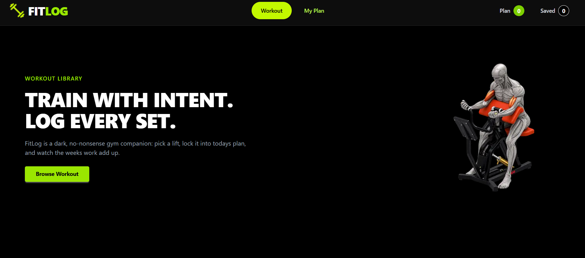
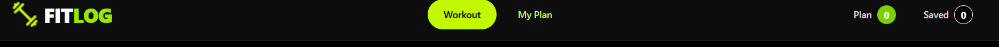
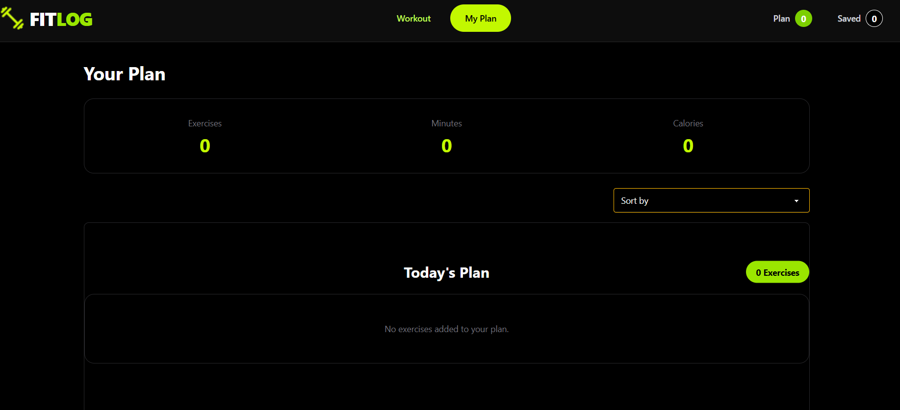
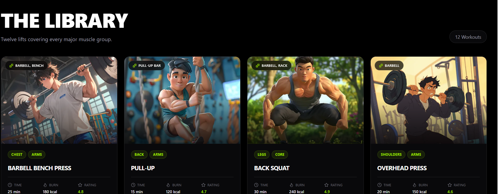
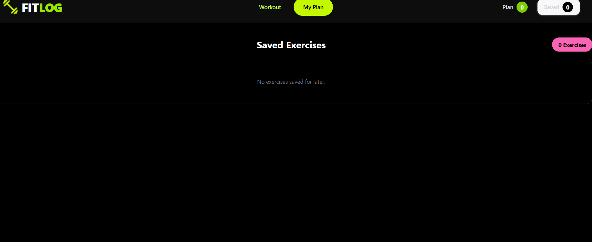

 # 💪 FitLog — Gym & Fitness Application

A modern fitness web application designed to help users explore exercises, discover workout information, and learn about different fitness activities.

<p align="center">
  <a href="https://my-gym-project-diar.vercel.app/">
    
  </a>
  <a href="https://github.com/jubairhs115-cell/my-gym-project">
    
  </a>
</p>

---

## 📖 About The Project

**FitLog** is a fitness-focused web application developed to make exercise discovery and workout exploration easier.

Users can explore different exercises, learn about the muscles involved, check the required equipment, and view workout information such as duration, calories burned, sets, and repetitions.

The project focuses on providing a clean, modern, and responsive experience for people interested in fitness and exercise.

## ✨ Key Features

### 🏋️ Exercise Discovery
- Explore a collection of fitness exercises.
- View exercise names and descriptions.
- Discover exercises based on muscle groups.
- Explore different exercise categories.

### 💪 Exercise Information
- View targeted muscle groups.
- Check required workout equipment.
- Explore exercise difficulty levels.
- View estimated workout duration.
- Check estimated calories burned.
- View sets, repetitions, and exercise ratings.

### 🎨 User Interface
- Modern and responsive user interface.
- Reusable components built with React.
- Styling with Tailwind CSS and daisyUI.
- Dynamic exercise detail pages.

## 🛠️ Technologies Used

### Frontend Development
- Next.js
- React
- TypeScript
- Tailwind CSS
- daisyUI

### API Integration
- REST API
- Fetch API

### Tools & Platforms
- Git
- GitHub
- Visual Studio Code
- Vercel

## 🚀 Getting Started

Follow these instructions to run the project locally.

### Prerequisites

Make sure you have installed:

- Node.js
- npm
- Git

### Installation

**1. Clone the repository**

```bash
git clone https://github.com/jubairhs115-cell/my-gym-project.git
```

**2. Navigate to the project directory**

```bash
cd my-gym-project
```

**3. Install dependencies**

```bash
npm install
```

**4. Configure environment variables**

If your project uses environment variables, create a `.env.local` file in the root directory and add the required configuration.

For example:

```env
NEXT_PUBLIC_API_URL=https://my-gym-project-diar.vercel.app/
```

Use the exact variable name expected by your application.

**5. Start the development server**

```bash
npm run dev
```

**6. Open the application**

Visit:

```text
http://localhost:3000
```

## 🔌 API Integration

FitLog retrieves exercise information through an external API.

The exercise data includes information such as:

- Exercise name and image
- Muscle groups
- Equipment
- Difficulty level
- Duration
- Calories burned
- Sets and repetitions
- Rating and description

## 🌐 Deployment

Add your deployed application URL here:

[Visit FitLog Live Application](https://my-gym-project-diar.vercel.app/)

## 📂 Project Repository

[View FitLog Source Code on GitHub](https://github.com/jubairhs115-cell/my-gym-project)

## 👨‍💻 Author

**Jubair Hossain**

Computer Science & Engineering Student | Aspiring Full-Stack Developer

- GitHub: [@jubairhs115-cell](https://github.com/jubairhs115-cell)
- Email: [jubairhs115@gmail.com](mailto:jubairhs115@gmail.com)

---

## 📸 Screenshots

### 🏋️ Gym Dashboard


### 🧭 Gym Navigation Bar


### 📋 Gym Plans


### 💪 Workout Section


### ⭐ Saved Plans


<p align="center">
  ⭐ If you find this project interesting, consider giving it a star!
</p>
